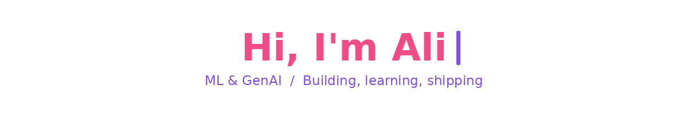
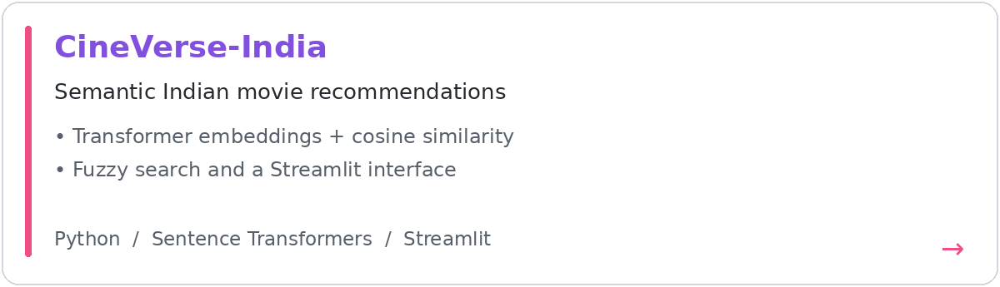
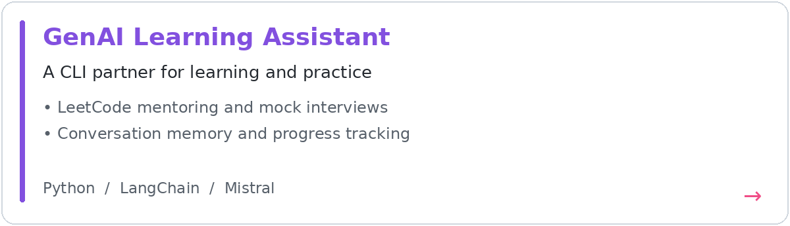
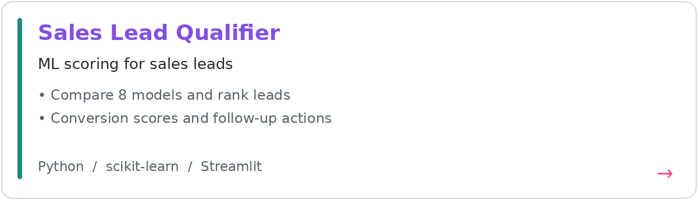
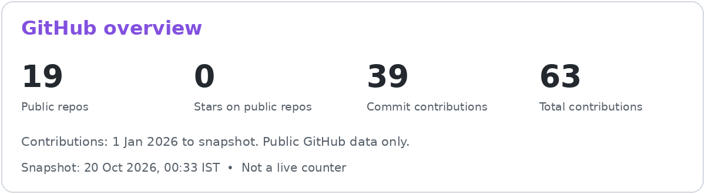
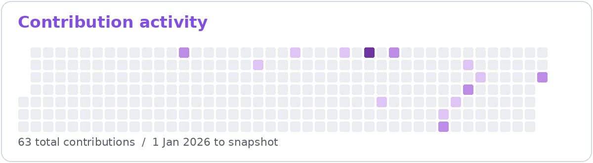

3rd-year B.Tech CSE (AI & ML) student at GITAM, Visakhapatnam (CGPA 9.79). I build ML and GenAI projects end to end, from data and models to working apps.

### About me
- Interested in Machine Learning, Data Science and Generative AI.

### Languages and tools

Also: SQL, LangChain, RAG, ChromaDB, Hugging Face, Whisper, Streamlit, pandas and Plotly.

### Featured projects

CineVerse-India: Transformer embeddings, cosine similarity, fuzzy search and Streamlit.

GenAI Learning Assistant: CLI chatbot with LangChain, Mistral, conversation memory and interview practice.

Sales Lead Qualifier: compares 8 scikit-learn models and ranks leads in a Streamlit dashboard. 5th of 60 teams at Idea Sprint 3.0.

### GitHub overview

Snapshot, 20 Oct 2026, 00:33 IST: 19 public repositories, 0 stars on public repositories, 39 commit contributions and 63 total contributions since 1 Jan 2026. Contributions include activity other than commits. These are not live counters.

### Beyond code
- Mentored 200+ students in mathematics, data structures, design and analysis of algorithms, DBMS and operating systems as a CHITTI instructor (2025-26).
- WebArcs Domain Lead, Meta Developers Community GITAM.

### Connect

Static greeting fallback

