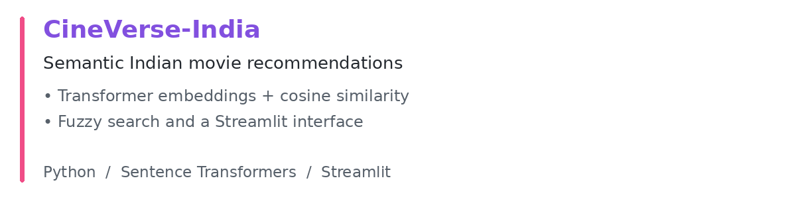
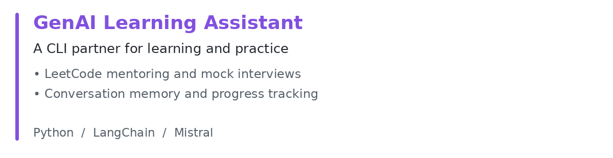
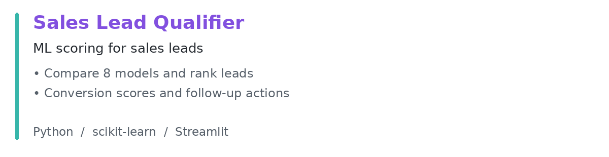
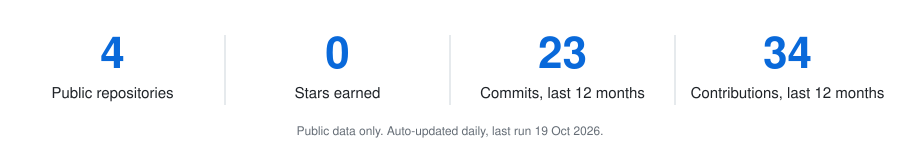
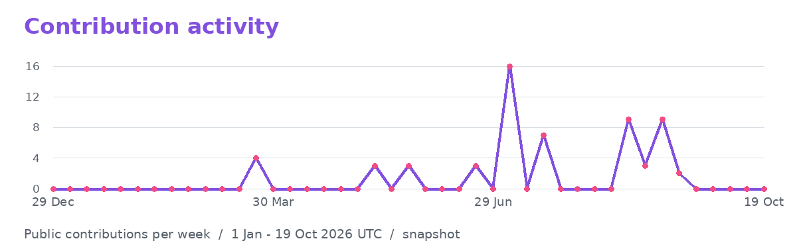

<picture>
  <source media="(prefers-color-scheme: dark)" srcset="assets/themes/dark/greeting.gif">
  <source media="(prefers-color-scheme: light)" srcset="assets/themes/light/greeting.gif">
  
</picture>

3rd-year B.Tech CSE (AI & ML) student at GITAM, Visakhapatnam (CGPA 9.79). I build ML and GenAI projects end to end, from data and models to working apps.

### About me
- Interested in Machine Learning, Data Science and Generative AI.

### Languages and tools

Also: SQL, LangChain, RAG, ChromaDB, Hugging Face, Whisper, Streamlit, pandas and Plotly.

### Featured projects
<a href="https://github.com/MohamedAli077/CineVerse-India">
<picture>
  <source media="(prefers-color-scheme: dark)" srcset="assets/themes/dark/cineverse.png">
  <source media="(prefers-color-scheme: light)" srcset="assets/themes/light/cineverse.png">
  
</picture>
</a>
CineVerse-India: Transformer embeddings, cosine similarity, fuzzy search and Streamlit.

<a href="https://github.com/MohamedAli077/genai-learning-assistant">
<picture>
  <source media="(prefers-color-scheme: dark)" srcset="assets/themes/dark/learning.png">
  <source media="(prefers-color-scheme: light)" srcset="assets/themes/light/learning.png">
  
</picture>
</a>
GenAI Learning Assistant: CLI chatbot with LangChain, Mistral, conversation memory and interview practice.

<a href="https://github.com/MohamedAli077/sales-lead-qualifier-system">
<picture>
  <source media="(prefers-color-scheme: dark)" srcset="assets/themes/dark/leads.png">
  <source media="(prefers-color-scheme: light)" srcset="assets/themes/light/leads.png">
  
</picture>
</a>
Sales Lead Qualifier: compares 8 scikit-learn models and ranks leads in a Streamlit dashboard. 5th of 60 teams at Idea Sprint 3.0.

### GitHub overview
<picture>
  <source media="(prefers-color-scheme: dark)" srcset="assets/themes/dark/stats.svg">
  <source media="(prefers-color-scheme: light)" srcset="assets/themes/light/stats.svg">
  
</picture>
<picture>
  <source media="(prefers-color-scheme: dark)" srcset="assets/themes/dark/activity.png">
  <source media="(prefers-color-scheme: light)" srcset="assets/themes/light/activity.png">
  
</picture>

<picture>
  <source media="(prefers-color-scheme: dark)" srcset="assets/themes/dark/line.png">
  <source media="(prefers-color-scheme: light)" srcset="assets/themes/light/line.png">
  
</picture>

### Beyond code
- Mentored 200+ students in mathematics, data structures, design and analysis of algorithms, DBMS and operating systems as a CHITTI instructor (2025-26).
- WebArcs Domain Lead, Meta Developers Community GITAM.

### Connect

